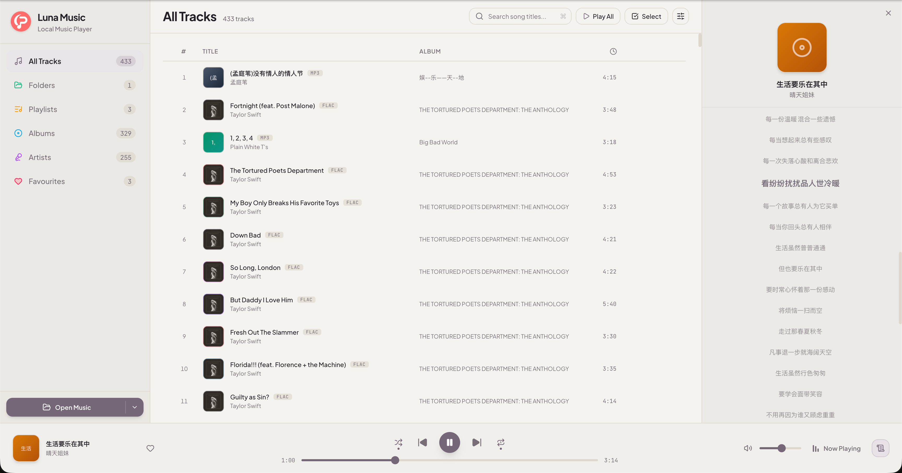
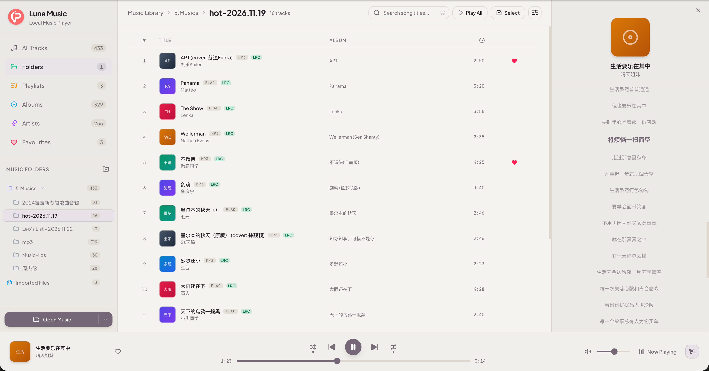
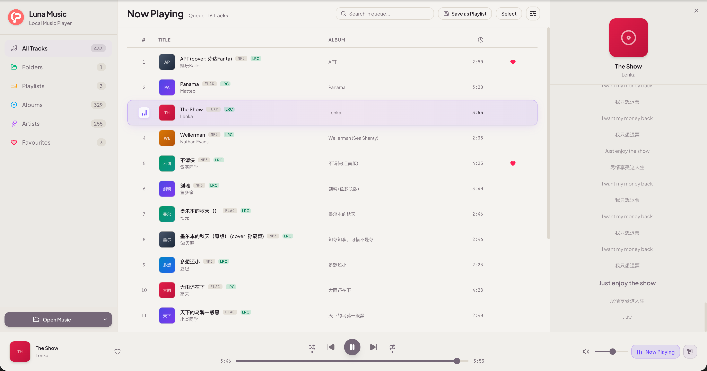
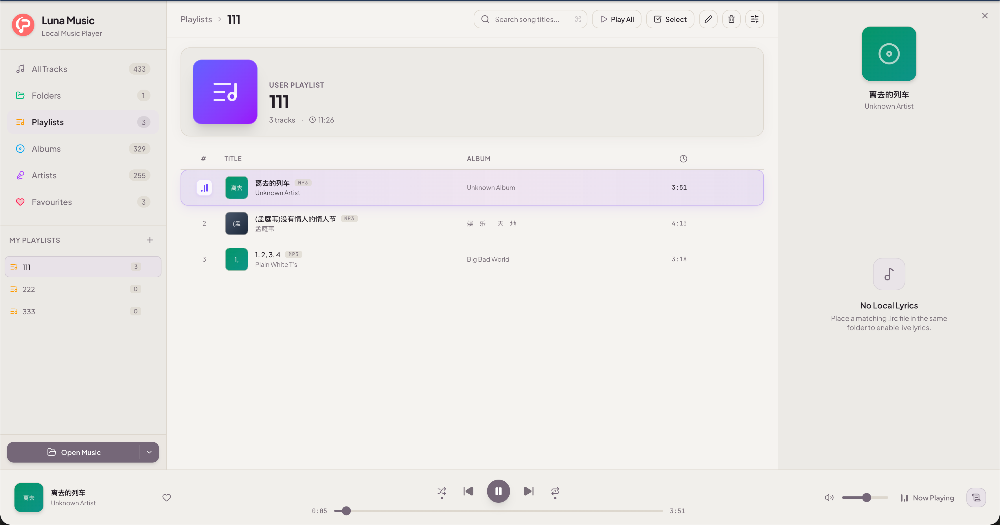
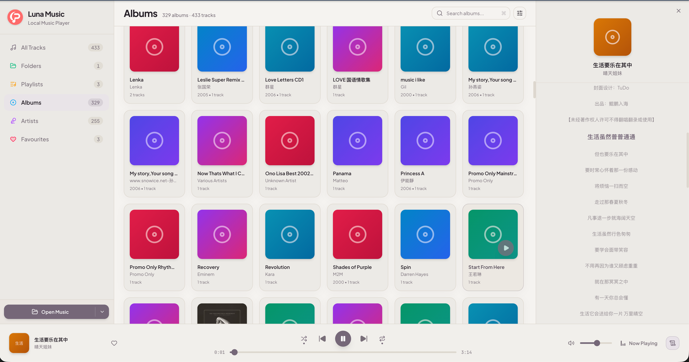

# Luna Music

Luna Music is a browser-based local music player for desktop audio libraries. It runs entirely client-side with no backend, accounts, or file uploads, combining folder-based library management with playlists, synchronized local lyrics, and a persistent playback queue.

**Live Demo:** https://music.jinleo.dev/



## Key Features

### Local Library & Navigation
- **Folder and File Import:** Import one or more local music folders or individual audio files (`MP3`, `FLAC`, `WAV`, `M4A`, `AAC`, `OGG`, `OPUS`, `WEBA`).
- **Recursive Folder Browsing:** Navigate nested directories with breadcrumbs, subfolder cards, natural numeric sorting, and a dedicated `Imported Files` collection.
- **Library Views:** Browse by **All Tracks**, **Music Folders**, **Playlists**, **Albums**, **Artists**, and **Favourites**.
- **Contextual Search:** Filter each view by its primary displayed name (song titles in track lists, collection names in overviews, and folder names alongside direct songs in Folder Detail).

### Playback, Queue & Now Playing
- **Full Playback Controls:** Play/Pause, Previous/Next, seek bar, volume/mute, Shuffle, and Repeat (`off`, `all`, `one`).
- **Now Playing & Queue Management:** Dedicated Now Playing queue view accessible via the bottom-player toggle button, track-info area, or empty bottom-player space; supports **Play Next**, **Add to Queue**, queue search, item removal, and saving the current queue as a playlist.
- **Multi-Select & Bulk Actions:** Select multiple tracks to bulk-add to Queue, Playlists, or Favourites, or remove entries in batch.

### Playlists, Metadata & Local Lyrics
- **Custom Playlists & Favourites:** Create, rename, delete, and reorder playlists; mark favourite tracks across all views.
- **Client-Side Metadata & Artwork:** Extracts embedded tags (title, artist, album, duration) and cover art on demand using `music-metadata`, with deterministic gradient placeholders when artwork is absent.
- **Synchronized Local Lyrics (`.lrc`):** Automatically pairs local `.lrc` files placed alongside audio tracks, highlights and auto-scrolls the active line, and supports clicking any line to seek. *(Local `.lrc` files only; online lyrics lookup and AI transcription are not implemented.)*

### Appearance & Persistence
- **Themes:** Dark mode and three Light styles (**Warm**, **Neutral**, **Mist**) via the header Appearance menu.
- **Local Persistence & Recovery:** Stores folder handles, imported file records, playlists, favourites, theme preferences, and playback state in IndexedDB and `localStorage`, with one-click permission restoration when folders require re-authorization.

## Screenshots

<table>
  <tr>
    <td align="center" width="50%">
      <br />
      <sub><strong>Music Folders &amp; Local Lyrics</strong> — Recursive folder browsing with synced <code>.lrc</code> panel</sub>
    </td>
    <td align="center" width="50%">
      <br />
      <sub><strong>Now Playing</strong> — Active queue, unified playing-row highlight, and queue actions</sub>
    </td>
  </tr>
  <tr>
    <td align="center" width="50%">
      <br />
      <sub><strong>Playlists</strong> — Custom playlist management, track actions, and reordering</sub>
    </td>
    <td align="center" width="50%">
      <br />
      <sub><strong>Albums</strong> — Grouped album overview with contextual search</sub>
    </td>
  </tr>
</table>

## Tech Stack

- **UI & Build:** React 19, TypeScript, Vite, Tailwind CSS v4, Lucide React
- **Audio & Metadata:** Native `HTMLAudioElement` / browser audio APIs, `music-metadata`
- **Local Access & Persistence:** Browser File System Access API (with file-input fallback), IndexedDB, `localStorage`
- **Testing:** Vitest, jsdom

## Getting Started

### Prerequisites

- Node.js 18+ and npm
- A modern desktop browser (Chromium-based browsers recommended for persistent folder access)

### Run Locally

```bash
npm install
npm run dev
```

Open `http://localhost:5173` in your browser, then click **Open Music** to import a local music folder or individual audio files.

### Test & Build

```bash
# Run the automated test suite
npm test

# Type-check and create a production build
npm run build

# Preview the production build locally
npm run preview
```

## Architecture

Luna Music is structured as a client-side React application with clear separation between file access, state hooks, and presentation:

- **Local File Access (`src/services/`):** Uses `showDirectoryPicker` / `showOpenFilePicker` when supported, automatically falling back to standard file-input selection when the File System Access API is unavailable.
- **Library Scanning & Metadata (`src/utils/`, `src/hooks/`):** Builds a unified multi-folder tree with deduplicated canonical track identities, parses ID3/Vorbis/MP4 tags and embedded artwork asynchronously, and caches metadata locally.
- **Playback & Queue (`src/hooks/useAudioPlayer.ts`):** Manages `HTMLAudioElement` lifecycle, object-URL cleanup, queue ordering, shuffle/repeat state, and playback error toasts.
- **Persistence & Restoration (`src/services/idbStorage.ts`):** Persists registered folder handles, playlists, favourites, navigation, and playback settings in IndexedDB (`LunaMusicDB`) and `localStorage`.

## Keyboard Shortcuts

| Shortcut | Action |
| :--- | :--- |
| `Space` | Play / Pause |
| `←` / `→` | Seek backward / forward 5 seconds |
| `⌘` / `Ctrl` + `←` | Previous track |
| `⌘` / `Ctrl` + `→` | Next track |
| `↑` / `↓` | Volume up / down (5%) |
| `M` | Toggle mute |
| `L` | Toggle synchronized lyrics panel |
| `?` | Open / close keyboard shortcuts help |
| `Esc` | Close shortcuts dialog |

*Shortcuts are automatically ignored while typing inside search inputs or modal fields.*

## Browser Compatibility & Limitations

- **File System Access API:** Persistent folder handles and one-click permission recovery require a browser that supports the File System Access API (such as Chrome, Edge, or Brave on desktop).
- **Permission Re-Authorization:** Browsers do not guarantee permanent folder permissions across restarts; when a browser revokes handle permission, Luna Music displays a recovery prompt to re-grant access without losing playlists or favourites.
- **Fallback File-Input Mode:** In browsers without directory-picker support (such as Firefox or Safari), files can still be imported via standard file selection for the current session, but file handles cannot be persisted across reloads.
- **Autoplay on Refresh:** Browsers may block automatic audio resumption after a page refresh until the user interacts with the page; in that case Luna Music restores the track and position cleanly in a paused state.
- **Local Lyrics Only:** Lyrics display requires a matching `.lrc` file in the same folder as the audio file.

## License

MIT
